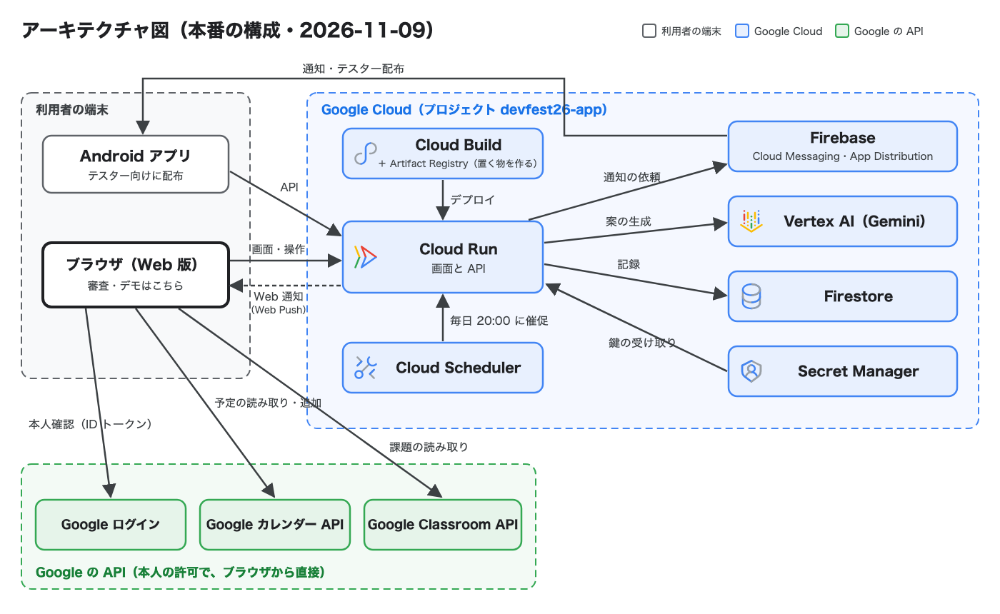

# モル塔（MolTower）— 考え続ける力を育てる

DevFest GDGoC Japan Hackathon 2026 ／ チーム Shrimp（東京会場）の提出物です。

モル塔は、課題に向かう人が AI から答えをもらわずに、自分で決めて考え続けるためのアプリです。相談相手の AI エージェント「モルティ（Molty）」は答えを言わず、問い返すか、やり方を説明するところで止まります。目標とロードマップ（進め方）を決めるのは本人で、集中した時間は塔の階として積み上がり、自分で考えた分は「シェル」として残ります。

- 課題・根拠・既存手法との違い・Google 技術の使い方は、提出した「プロダクト説明ドキュメント_Shrimp」に書いています。
- デプロイした URL と審査用の入り方も、説明ドキュメントの「5. プロジェクトをデプロイしたURL」に書いています（この README には載せていません。Gemini の 1 日の上限を審査に残すためです）。

## 構成



- **Cloud Run**: 画面（Expo の Web 書き出し）と API（Node.js）を 1 つのコンテナで配ります（東京リージョン）。時間と点はサーバーで計算します。
- **Vertex AI の Gemini**: 進め方の 3 案（構造化出力）、答えを言わない相談、ノートの写真・メモ・声からの達成度の判定、課題の候補の取り出し。端末からは直接呼ばず、必ずサーバーを通します。
- **Firestore**: 目標・選んだ理由・集中の記録・判定の結果。
- **Secret Manager**: 招待コード・署名の鍵・Web 通知の鍵などを Cloud Run に渡します。
- **Cloud Scheduler**: 毎日 20:00（日本時間）に、その日まだ取り組んでいない人へ催促を送る処理を呼びます。
- **Firebase**: Android 版への通知（Cloud Messaging）と、テスターへの配布（App Distribution）。
- **Google ログイン・Google カレンダー API・Google Classroom API**: Web 版で、本人の許可を得てブラウザから直接読みます。中身はサーバーに送りません。

## ディレクトリ

```
app/api/      サーバー（Node.js・依存パッケージなし）。Gemini・Firestore・認証・通知
app/mobile/   画面（Expo SDK 58・TypeScript・expo-router）。Web と Android
Dockerfile    Cloud Run 用（画面の Web 書き出しとサーバーを 1 つにまとめる）
architecture/       アーキテクチャ図（SVG と PNG）
```

## 手元で動かす

サーバーなしで、画面の流れを一通り確かめられます（AI の返事と判定は偽物・データはメモリだけ）。

```sh
cd app/mobile
npm ci
npm run web:mock
```

試験:

```sh
cd app/mobile && npm test   # 型の検査と画面側の試験
cd app/api && npm test      # サーバー側の試験
```

本番と同じ形（Cloud Run）で動かすには、Google Cloud のプロジェクトと、`.env.example` にある変数（値は Secret Manager から渡す）が必要です。

## ライセンス

[MIT License](LICENSE)。使ったライブラリ・素材・データの出典は、提出した「著作物利用シート_Shrimp」に書いています。
